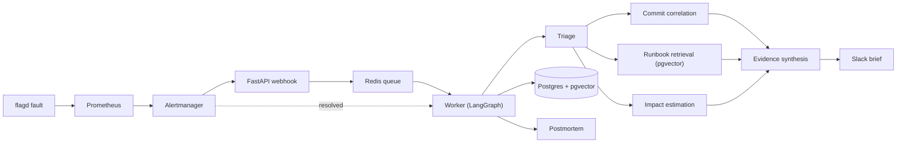

# Glassbox SRE

An AI agent that investigates production alerts. When Prometheus fires, Glassbox finds the deploy most likely to have caused it, pulls the matching runbook, computes the real impact from telemetry, and posts a cited brief to Slack. When the alert resolves, it writes a postmortem from the stored event log.

**Live demo:** https://ai-sre-new.vercel.app (static build with recorded sample data; the full system runs locally, see below)

It is read-only. It never rolls back, restarts, or changes flags. It runs against the [OpenTelemetry Astronomy Shop demo][otel-demo] with real fault injection, not a production system.

## How it works



1. Alertmanager posts the alert to FastAPI, which queues it in Redis and returns immediately.
2. A worker runs a LangGraph graph: triage, then three investigators in parallel.
   - **Commit correlation:** filters deploys to the alert window and service, then an LLM reads the diffs and ranks the likely culprit.
   - **Runbook retrieval:** tag filter plus pgvector similarity.
   - **Impact:** real Prometheus queries and plain arithmetic. The LLM never touches these numbers.
3. Findings merge into one brief, each claim citing its source, posted via Slack Bolt.
4. Everything is stored in Postgres. A React dashboard reads it.

The LLM only does two things: classify the alert and rank pre-filtered diffs. Counts, citations, severity and postmortem timelines are deterministic.

**Stack:** Python, FastAPI, Redis, Postgres + pgvector, LangGraph, OpenAI (gpt-6-luna), Slack Bolt, Prometheus, OpenTelemetry, React.

## Benchmark

15 scenarios, each with a known bad commit hidden among same-service deploys that look just as plausible on timing and service alone.

| Mode | Commit top-1 | Top-3 | Runbook | Impact | p50 | p95 | Cost/run |
| --- | ---: | ---: | ---: | ---: | ---: | ---: | ---: |
| Heuristics only (`replay-fast`) | 13.3% | 66.7% | 100% | 100% | 27 ms | 56 ms | $0 |
| gpt-4.1-mini (baseline) | 86.7% | 100% | 100% | 100% | 6.5 s | 17.0 s | ~$0.025 |
| **gpt-6-luna (current)** | **100%** (15/15 in 4 of 4 runs) | 100% | 100% | 100% | 4.3 s | 6.1 s | ~$0.007 |

Heuristics tie on timing and service match, so they pick the wrong commit most of the time. Reading the change is what separates them. gpt-4.1-mini ranged 86.7% to 93.3% across runs; gpt-6-luna fixed the two scenarios it missed (`recommendation-timeout`, `frontend-product-catalog-latency`). Run artifacts are in `artifacts/evaluations/`.

**What this does not show:**
- 14 of 15 scenarios are synthetic replays; 1 is captured live. Deploy history is seeded.
- The scenario "diffs" are short change notes, not real source changes, and the benign ones say so. This measures ranking over change descriptions, not general incident-response accuracy.
- The benchmark covers one LLM call (diff ranking). Its runbook retrieval is lexical; the live pipeline uses pgvector.
- The score shown per candidate is a deterministic pre-rank score, not model confidence.

```bash
python -m glassbox_sre.run_benchmark --mode replay-fast   # no API key needed
python -m glassbox_sre.run_benchmark --mode model-eval    # needs OPENAI_API_KEY
python -m glassbox_sre.run_benchmark --mode model-eval \
  --scenario frontend-ad-failure-visible-500s --verbose   # one scenario, full reasoning
```

## Run it locally

Needs Python 3.11+, Docker, and an OpenAI API key (Slack is optional; without it the brief prints to the console).

```bash
git clone --recurse-submodules git@github.com:krishna31102004/ai-sre-new.git
cd ai-sre-new
python3 -m venv .venv && source .venv/bin/activate
pip install -e ".[dev]"
cp .env.example .env          # set OPENAI_API_KEY
pytest                        # fast suite, no Docker or key needed

docker compose -f infra/docker/docker-compose.yml up -d postgres redis
uvicorn glassbox_sre_api.main:app --port 8000      # terminal 1
python -m glassbox_sre_worker.main                 # terminal 2
```

Start the Astronomy Shop stack (see `infra/README.md`), then flip the `adFailure` flag. About five minutes later the alert fires and the brief lands. The full walkthrough is in [docs/DEMO.md](docs/DEMO.md).

Models are set in `.env`: `GLASSBOX_LLM_MODEL` and `GLASSBOX_REASONING_EFFORT` (diff ranking, default gpt-6-luna / medium), `GLASSBOX_TRIAGE_MODEL` and `GLASSBOX_TRIAGE_REASONING_EFFORT` (triage, default gpt-6-luna / low). The benchmark also accepts `--model` and `--reasoning-effort`.

## Repository

```text
apps/api/          FastAPI webhook ingestion
apps/worker/       Redis worker and LangGraph investigation
apps/frontend/     React dashboard
packages/core/     Schemas, storage, graph support, benchmark
infra/             Docker, Prometheus, Alertmanager, OTel demo overlay
runbooks/          Runbook corpus
scenarios/         Incident and benchmark ground truth
docs/              Demo walkthrough
```

## Limitations

- One alert at a time; related alerts are not grouped into one incident yet.
- The demo's metrics don't expose a latency histogram, so impact reports error rate and affected requests, never a made-up p95.
- The live loop needs Docker and a five-minute alert window, so it isn't part of CI.

## License

MIT. See [LICENSE](LICENSE).

[otel-demo]: https://github.com/open-telemetry/opentelemetry-demo
